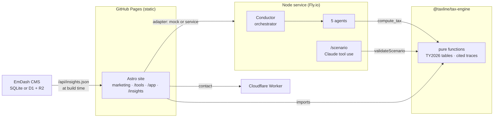

# Taxline

**Agentic tax operations with a tested engine and a human in the loop.**

Five AI agents move tax work from a pile of documents to a reviewer-ready workpaper. Every extracted field carries a confidence score and a citation. Every number comes from a deterministic, unit-tested 2026 tax engine, not from a model. Anything uncertain routes to a person, and nothing ships until someone approves it.

[](https://github.com/patrickking67/taxline/actions/workflows/ci.yml)
[](https://github.com/patrickking67/taxline/actions/workflows/deploy.yml)

**Live site:** [patrickking67.github.io/taxline](https://patrickking67.github.io/taxline/) · [Calculators](https://patrickking67.github.io/taxline/tools/) · [Product console](https://patrickking67.github.io/taxline/app/) · [Methodology](https://patrickking67.github.io/taxline/methodology/)

---

## What is in the box

| Piece | What it does | Where |
| --- | --- | --- |
| **Agent fleet** | Relay (intake), Lens (extraction), Atlas (research), Ledger (workpapers), and Sentry (compliance) behind a hub-and-spoke orchestrator on the Anthropic API. The agentic loop stops on `stop_reason`, errors are structured, and `requireHumanApproval` is a code gate. | `service/` |
| **Tax engine** | Pure TypeScript for tax year 2026. Covers the Form 1040 path (Tax Table midpoint rule, capital-gains worksheet, QBI with phase-in and SSTB, CTC/ACTC), Schedule SE, NIIT, Additional Medicare, the §6654 safe harbor, §179/bonus/MACRS, S-corp vs. sole prop, and practice ROI (NPV, IRR, payback). Every result is a trace: value, operands, form line, and IRS authority. | `packages/tax-engine/` |
| **AI intake** | Describe your situation in plain English and get calculator inputs back. Claude extracts each figure with an exact evidence quote; code then checks that the quote is in your text and states the amount. Fields under 0.85 confidence stay unchecked until you approve them. | `service/src/scenario.ts`, `packages/tax-engine/src/scenario.ts` |
| **Free calculators** | Six tools: income tax, self-employment tax, estimated tax, S-corp election, depreciation, and firm ROI. Each one recomputes live, keeps its state in the URL, has SVG charts, typesets its formulas in MathML, and produces a copyable cited workpaper. | `site/src/pages/tools/` |
| **Product console** | Intake queue, extraction review with confidence meters, a gated `compute_tax` preview, research, workpapers, and compliance. Fully functional on static hosting through an offline adapter. | `site/src/pages/app/` |
| **CMS** | [EmDash](https://github.com/emdash-cms/emdash) (Astro, SQLite locally, D1/R2 on Cloudflare) for Insights articles. The static site pulls published entries at build time and falls back to a committed snapshot. | `cms/`, `scripts/pull-insights.mjs` |
| **Contact Worker** | Cloudflare Worker for demo requests, with honeypot and email validation. | `workers/contact/` |

## Architecture



**The site never assumes a server exists.** `site/src/lib/api/` has two seams (`fleet` and `api`). Both default to offline implementations, so every page works on static Pages, and any backend that honors the contract drops in through environment variables.

## Design principles

- **Models draft, code computes, people approve.** No tax figure is produced by a prompt. The Workpaper agent calls `compute_tax` and quotes its trace.
- **Verify model output in code.** Extraction results are validated before they reach the calculator: known key, typed value, and an evidence quote that must appear in the input and state the value. Failures are capped below the review threshold with the reason attached, never dropped silently.
- **Cite everything.** Every 2026 figure lives in `packages/tax-engine/src/years/2026.ts` with its source, transcribed from [Rev. Proc. 2025-32](https://www.irs.gov/pub/irs-drop/rp-25-32.pdf), the SSA wage base, and Pub 946.
- **Test against the source, not the implementation.** Expected values are worked by hand from the IRS tables. The MACRS table is re-derived from first principles, and the S-corp comparison is checked line by line.
- **Confidence below 0.85 routes to a person.** The same threshold applies in the service, the offline demo, the intake panel, and the app.

## Quick start

```bash
npm install            # site + tax-engine workspaces + lint toolchain
npm run dev            # site            http://localhost:4321
npm run dev:service    # agent fleet     http://localhost:8787  (cd service && npm install first)
npm run dev:cms        # EmDash CMS      http://localhost:4322/_emdash/admin  (cd cms && npm install && npm run seed first)
```

Validate everything before a commit:

```bash
npm run check && npm run lint && npm run typecheck && npm test
```

The service reads `service/.env` (`ANTHROPIC_API_KEY`). Without a key, the fleet and the `/scenario` endpoint run in a clearly labeled deterministic offline mode.

## Using the engine

```ts
import { computeReturn, compareEntity } from '@taxline/tax-engine';

const r = computeReturn({ status: 'mfj', wages: 142_000, selfEmploymentProfit: 38_000, children: 2, federalWithholding: 16_500 });
r.totalTax;        // 20764.74
r.marginalRate;    // true marginal rate from a full recompute, not just the bracket
r.lines;           // [{ ref: '1040 L15', label: 'Taxable income', formula: '…', authority: {…} }, …]

compareEntity({ status: 'single', profit: 150_000, salary: 60_000, overhead: 2_000 }).savings; // 7275.61
```

## Repository map

```
site/                 Astro 5 static site: marketing, /tools, /insights, /methodology, the /app console
packages/tax-engine/  2026 federal tax math + scenario validation (29 tests, node:test via tsx)
service/              Node + TypeScript agent fleet on the Anthropic SDK; /agents/run, /scenario, memory
cms/                  EmDash CMS (Astro 7) for Insights; export endpoint at /api/insights.json
scripts/              pull-insights.mjs: CMS to static snapshot, atomic and validated
knowledge-base/       Markdown corpus the Research agent retrieves over, with a content-hash manifest
workers/contact/      Cloudflare Worker for the demo form
docs/                 design spec, design contract, system design and deploy runbook
```

## Deployment

| Target | How |
| --- | --- |
| Site | GitHub Actions to Pages on push to `main`. Set the repository variable `EMDASH_URL` to pull fresh Insights before each build. |
| Agent service | Root `Dockerfile` + `fly.toml` (`fly deploy`). |
| CMS | Node standalone (`cms/`, SQLite) or Cloudflare Workers with D1 + R2. See `cms/README.md`. |
| Contact Worker | `wrangler deploy` in `workers/contact/`. |

Full runbook: `docs/system-design.md`.

## Scope and honesty

Figures are federal only for tax year 2026. Each calculator lists what it does not model (AMT, EITC, state tax, the mid-quarter convention, and so on). Pricing on the site is representative, and the SOC 2 audit is marked in progress. Taxline never files autonomously and never trains on client data.

## License

MIT. See `LICENSE`.
