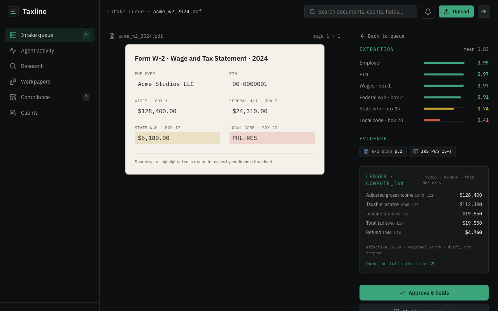
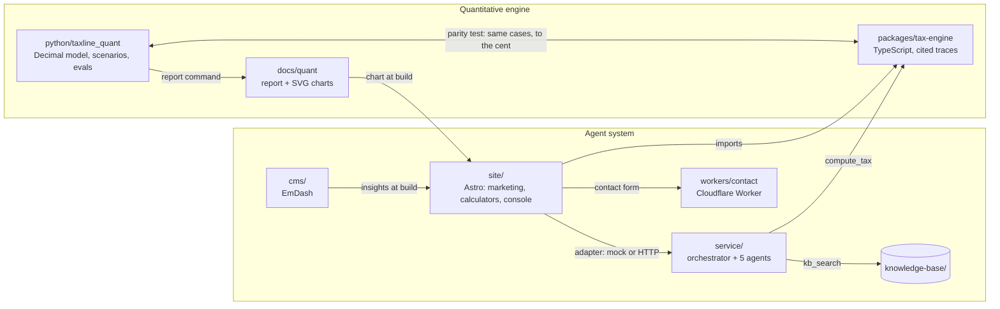
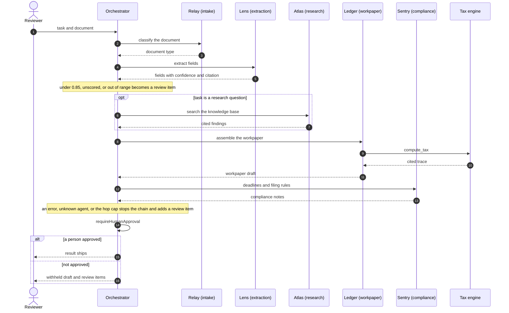
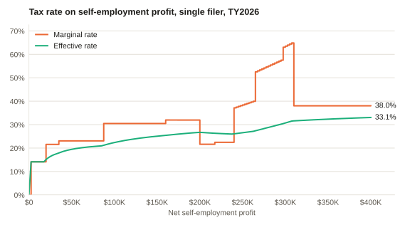

# Taxline

**Five AI agents take tax work from a pile of documents to a reviewer-ready workpaper, and a tax engine written twice, in TypeScript and Python, checks its own math to the cent.**

The model drafts, code computes, and a person approves. Every extracted field carries a confidence score and a citation, anything under 0.85 goes to a reviewer, and nothing ships without approval. Those controls are code with tests, not prompt text.

[](https://github.com/patrickking67/taxline/actions/workflows/ci.yml)
[](LICENSE)
[](https://patrickking67.github.io/taxline/)
[](python/pyproject.toml)

> Not tax advice. Taxline is an educational portfolio project on synthetic data (placeholder IDs such as EIN `00-0000001`). Nothing it produces should be filed or relied on. See [Limitations](#limitations).

[](https://patrickking67.github.io/taxline/app/)

## Try it

- **Live:** [site](https://patrickking67.github.io/taxline/) · [product console](https://patrickking67.github.io/taxline/app/) · [six calculators](https://patrickking67.github.io/taxline/tools/) · [methodology](https://patrickking67.github.io/taxline/methodology/)
- **Read:** [the generated quantitative report](docs/quant/report.md) · [architecture](docs/architecture.md)

```bash
npm ci && npm --prefix service ci      # Node 22.22+ (.nvmrc pins 22)
npm run dev                            # site at http://localhost:4321
npm run dev:service                    # agent fleet at http://localhost:8787, no API key needed
cd python && uv sync && uv run python -m taxline_quant tax --status single --se-profit 100000
```

Without `ANTHROPIC_API_KEY` the fleet runs its tools deterministically and says so, which is enough to watch routing and both gates:

```bash
curl -s localhost:8787/agents/run -H 'content-type: application/json' \
  -d '{"task":"Extract the W-2","agent":"extraction","docId":"acme_w2_2024"}'
```

The response traces `extraction`, `workpaper`, `compliance`, lists three review items (the approval gate plus fields at 0.65 and 0.39), and returns `approved: false` with the output withheld.

## What is technically interesting here

- **Two implementations that verify each other.** [`python/taxline_quant`](python/taxline_quant/model.py) models the same 2026 rules on `Decimal`. [`test_parity.py`](python/tests/test_parity.py) runs 47 named edge cases and 5,000 seeded random cases through both engines on every CI run and fails on a one-cent difference.
- **The parity test found a real bug.** The TypeScript engine rounded some exact half-cent ties down, because `43230.95 * 0.9` is `38907.854999999996` as a double. The fix is in [`money.ts`](packages/tax-engine/src/money.ts) with a [regression test](packages/tax-engine/test/engine.test.ts); 60,000 further random cases found nothing else.
- **Gates are code the model cannot change.** The agent loop stops on `stop_reason`, tools are least-privilege per agent, and `requireHumanApproval` runs last in [`orchestrator.ts`](service/src/orchestrator.ts). A model may ask for a stricter confidence threshold but never a looser one ([`confidence.ts`](service/src/tools/confidence.ts), [tests](service/test/confidence.test.ts)). Every early stop, including a clamped hop limit, creates a review item.
- **Every constant has a citation and a test.** Figures come from Rev. Proc. 2025-32, the Code, and SSA. The Python [citation table](docs/quant/constants.md) is generated from [`constants.py`](python/taxline_quant/constants.py), and a test fails if a figure lacks a source or the docs drift.
- **Extraction is real code with measured confidence.** `extract_fields` runs a deterministic [rules extractor](service/src/extract/rules.ts): it finds each box by its caption, validates the value's format, and checks boxes against each other (6.2% and 1.45% on a W-2, 24% backup withholding on a 1099-NEC). Confidence comes from those signals, and the [evaluation harness](python/taxline_quant/evals/metrics.py) scores the same code on 600 held-out synthetic scans: 95.8% precision, 92.7% recall, calibration error 0.015, and 1.7% of auto-accepted fields wrong at the 0.85 gate ([report, section 5](docs/quant/report.md#5-extraction-evaluation)).
- **A model can only add doubt.** With an API key, the model reads the same text and [`reconcile.ts`](service/src/extract/reconcile.ts) compares the two. Agreement changes nothing; any disagreement caps the field under the review threshold and shows both readings to the reviewer.
- **Uncertainty with the assumptions attached.** A seeded [Monte Carlo](python/taxline_quant/montecarlo.py) projects required estimated payments when profit is uncertain and returns its assumptions with the result. Expected values in the tests are worked by hand; [hypothesis](python/tests/test_brackets.py) covers the invariants.

## Architecture

The repo has two halves: the agent system and the quantitative engine.



Agents never call each other. The orchestrator runs one, follows its static handoff, aggregates fields, citations, and review items, and applies the approval gate last.



[docs/architecture.md](docs/architecture.md) has the confidence and review-routing logic, the Python model's calculation flow, and the cross-check pipeline. [docs/system-design.md](docs/system-design.md) covers deployment and trust boundaries.

## The quantitative engine

<picture>
  <source media="(prefers-color-scheme: dark)" srcset="docs/quant/rates-dark.svg">
  
</picture>

Drawn by `python -m taxline_quant report`, which rebuilds [docs/quant/report.md](docs/quant/report.md) from fixed parameters and seeds. The spike is real: between about $238,000 and $308,000 of profit the section 199A deduction phases out for a business with no W-2 wages.

```bash
cd python
uv run python -m taxline_quant sweep --status single --vary self-employment-profit --start 0 --stop 300000 --step 50000
uv run python -m taxline_quant montecarlo --status single --se-profit 120000 --cv 0.35 --seed 7
uv run python -m taxline_quant eval            # the service's rules extractor; needs Node
uv run python -m taxline_quant parity
```

Package guide: [python/README.md](python/README.md).

## Quality signals

| Signal | Current state | Where |
| --- | --- | --- |
| Tax engine (TypeScript) | 37 tests, expected values worked by hand from IRS tables | `packages/tax-engine/test/` |
| Quant package (Python) | 126 tests: hand-worked cases, hypothesis properties, CLI, report, the rules extractor on rendered scans | `python/tests/` |
| Cross-implementation parity | 47 named + 5,000 seeded cases, money equal to the cent, constants compared | `python/tests/test_parity.py` |
| Agent service | 54 tests on a fake Messages client: loop, gates, routing, HTTP boundary, extraction and the model cross-check | `service/test/` |
| Contact Worker | 7 tests | `workers/contact/test/` |
| End to end | 36 Playwright tests against the production build under `/taxline` | `site/e2e/` |
| Accessibility | axe WCAG 2.1 AA (serious and critical) on every sitemap page | `site/e2e/pages.spec.ts` |
| Static checks | ESLint, Prettier, `tsc`, `astro check`, ruff, `mypy --strict` | `npm run verify` |
| CI matrix | Node 22; Python 3.12 and 3.13 | `.github/workflows/ci.yml` |
| Secrets and data | No key needed for any test; no live model call in tests; synthetic fixtures only | `AGENTS.md` |

## Project layout

```
site/                 Astro 7 static site: marketing, /tools, /insights, the /app console
service/              Node + TypeScript agent fleet on the Anthropic SDK
packages/tax-engine/  TY2026 federal tax math in TypeScript, plus parity/ for the cross-check
python/               taxline_quant: Decimal model, scenarios, Monte Carlo, evals, CLI
workers/contact/      Cloudflare Worker for the demo form
cms/                  EmDash CMS for Insights
knowledge-base/       Markdown corpus the research agent retrieves over
docs/                 architecture, system design, generated quant report and charts
```

## Checks

```bash
npm run verify:fast     # lint, format, typechecks, engine + service + Worker tests
npm run verify:python   # ruff, mypy --strict, pytest, with the parity test required (needs uv)
npm run verify          # everything CI runs, including the site build and Playwright + axe
```

Setup details, every command, and conventions are in [AGENTS.md](AGENTS.md). Environment variables are optional and documented in [`service/.env.example`](service/.env.example) and [`site/.env.example`](site/.env.example).

## Deploy

The site publishes to GitHub Pages from `main` through `.github/workflows/deploy.yml`. The service has a root `Dockerfile` and `fly.toml`; the Worker deploys with `wrangler deploy`. Runbook: [docs/system-design.md](docs/system-design.md).

## Limitations

- **Not tax advice, federal only, tax year 2026.** A qualified person must check every figure, citation, and deadline. Taxline never files anything.
- **Extraction reads text, not images.** The rules extractor parses the text layer of three forms (W-2, 1099-NEC, 1099-INT) in two layouts; there is no OCR, no upload path, and no parser for K-1s, schedules, or invoices. Its evaluation uses synthetic documents and a synthetic noise model, so the scores say nothing about real scans. The model cross-check is covered by tests on a fake client and has not been run against the live API here.
- **The Python model is narrower than the TypeScript engine.** No capital gains, credits, NIIT, or AMT; parity covers the inputs both accept.
- **Monte Carlo output is a projection under stated assumptions** (lognormal profit, fixed everything else), not a forecast.
- **The service is a local demo with no authentication.** `approved` is a request field. Put it behind auth before any real use.
- **Seed content.** The knowledge base and deadline rules are seeds that point to the IRS for verification. Pricing on the site is illustrative and the SOC 2 note says "in progress".

## Contributing, security, license

[CONTRIBUTING.md](CONTRIBUTING.md) · [SECURITY.md](SECURITY.md) · [CHANGELOG.md](CHANGELOG.md) · MIT, see [LICENSE](LICENSE).
