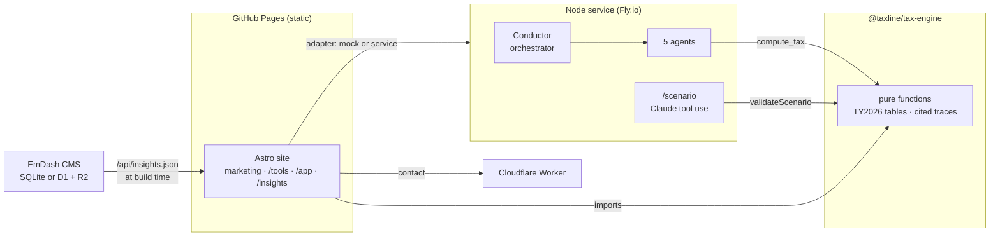
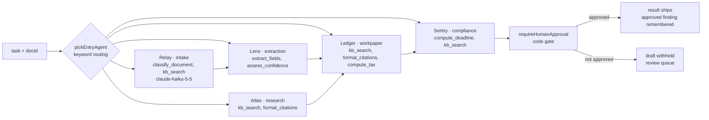

# Taxline

**Agentic tax operations with a tested engine and a human in the loop.**

Five AI agents move tax work from a pile of documents to a reviewer-ready workpaper. Every extracted field carries a confidence score and a citation. Every number comes from a deterministic, unit-tested 2026 tax engine, not from a model. Anything uncertain routes to a person, and nothing ships until someone approves it.

The interesting part is where the controls live. The model drafts; code decides. The confidence threshold, the approval gate, tool permissions, and input validation are all enforced in TypeScript and covered by tests, so a prompt (or a document that tries to act like one) cannot switch them off.

> Taxline is a portfolio project, not tax software. It is not tax, legal, or accounting advice, and nothing it produces should be filed without review by a qualified professional. See [Limitations](#limitations-and-disclaimer).

[](https://github.com/patrickking67/taxline/actions/workflows/ci.yml)
[](LICENSE)

**Live site:** [patrickking67.github.io/taxline](https://patrickking67.github.io/taxline/) · [Calculators](https://patrickking67.github.io/taxline/tools/) · [Product console](https://patrickking67.github.io/taxline/app/) · [Methodology](https://patrickking67.github.io/taxline/methodology/)

---

## What is in the box

| Piece | What it does | Where |
| --- | --- | --- |
| **Agent fleet** | Relay (intake), Lens (extraction), Atlas (research), Ledger (workpapers), and Sentry (compliance) behind a hub-and-spoke orchestrator on the Anthropic API. The agentic loop stops on `stop_reason`, errors are structured, and `requireHumanApproval` is a code gate. | `service/` |
| **Tax engine** | Pure TypeScript for tax year 2026. Covers the Form 1040 path (Tax Table midpoint rule, capital-gains worksheet, QBI with phase-in and SSTB, CTC/ACTC), Schedule SE, NIIT, Additional Medicare, the §6654 safe harbor, §179/bonus/MACRS, S-corp vs. sole prop, and practice ROI (NPV, IRR, payback). Every result is a trace: value, operands, form line, and IRS authority. | `packages/tax-engine/` |
| **AI intake** | Describe your situation in plain English and get calculator inputs back. Claude extracts each figure with an exact evidence quote; code then checks that the quote is in your text and states the amount. Fields under 0.85 confidence stay unchecked until you approve them. | `service/src/scenario.ts`, `packages/tax-engine/src/scenario.ts` |
| **Free calculators** | Six tools: income tax, self-employment tax, estimated tax, S-corp election, depreciation, and firm ROI. Each one recomputes live, keeps its state in the URL, has SVG charts, typesets its formulas in MathML, and produces a copyable cited workpaper. | `site/src/pages/tools/` |
| **Product console** | Intake queue, extraction review with confidence meters, a gated `compute_tax` preview, research, workpapers, and compliance. Fully functional on static hosting through an offline adapter. | `site/src/pages/app/` |
| **CMS** | [EmDash](https://github.com/emdash-cms/emdash) (Astro, SQLite locally, D1/R2 on Cloudflare) for Insights articles. The static site pulls published entries at build time and falls back to a committed snapshot. | `cms/`, `scripts/pull-insights.mjs` |
| **Quality gates** | 35 hand-worked engine tests, 32 service tests for the agent loop, the confidence gate, orchestration, the HTTP boundary, and filing deadlines, 7 contact Worker tests, plus Playwright end-to-end tests against the production build under the real `/taxline` base path. Every page in the sitemap must pass axe WCAG 2.1 AA (serious and critical), load with no console errors, and link only to pages that exist. | `packages/tax-engine/test/`, `service/test/`, `workers/contact/test/`, `site/e2e/` |
| **Contact Worker** | Cloudflare Worker for demo requests, with honeypot and email validation. | `workers/contact/` |

## Architecture



### How the five agents hand off

The orchestrator (`service/src/orchestrator.ts`) is the hub. It picks the entry agent from the task text (or takes one explicitly), runs it, follows that agent's static `handoff`, and aggregates fields, citations, and review items along the way. Agents never call each other, and each one gets only the tools it needs.



Every agent except intake runs on `claude-opus-5-5`. The chain ends at compliance, and a hop cap of 5 is a backstop, not the stop rule. A client `maxHops` is clamped to 1 through 5, and if the cap ends the chain early the result carries a review item naming the agent that did not run. After each agent the hub does three things in code:

1. **Confidence.** Fields come from `extract_fields`, and any field under 0.85, with no score, or with a score outside 0 to 1 goes to review. `assess_confidence` can raise the bar but never lower it, and a field it calls "passed" only counts if it matches an extracted field, so the model cannot restate a score or invent a value.
2. **Errors.** Every tool failure becomes a review item. A failed model call (rate limit, outage, bad key) returns a structured error instead of throwing, is labeled retryable or not, and stops the chain. A truncated answer, a refusal, or the 12-turn loop backstop is also flagged.
3. **Approval.** `requireHumanApproval` runs last. Without approval the output is wrapped as a withheld draft. Only an approved result with no open review items and at least one citation is written to memory.

**The site never assumes a server exists.** `site/src/lib/api/` has two seams (`fleet` and `api`). Both default to offline implementations, so every page works on static Pages, and any backend that honors the contract drops in through environment variables.

## Design principles

- **Models draft, code computes, people approve.** No tax figure is produced by a prompt. The Workpaper agent calls `compute_tax` and quotes its trace.
- **Verify model output in code.** Extraction results are validated before they reach the calculator: known key, typed value, and an evidence quote that must appear in the input and state the value. Failures are capped below the review threshold with the reason attached, never dropped silently.
- **Cite everything.** Every 2026 figure lives in `packages/tax-engine/src/years/2026.ts` with its source, transcribed from [Rev. Proc. 2025-32](https://www.irs.gov/pub/irs-drop/rp-25-32.pdf), the SSA wage base, and Pub 946.
- **Test against the source, not the implementation.** Expected values are worked by hand from the IRS tables. The MACRS table is re-derived from first principles, and the S-corp comparison is checked line by line.
- **Confidence below 0.85 routes to a person.** The same threshold applies in the service, the offline demo, the intake panel, and the app.
- **Documents are data, not instructions.** Task context is fenced and every agent's system prompt says to ignore instructions found in documents or tool results. That is defense in depth only: the controls that matter (least-privilege tools, the confidence gate, the approval gate) are code the model cannot change.

## Quick start

Requires Node `^22.22.3`, `^24.16.0`, or `>=26.3.0` (Astro 7 and the ESLint 10 toolchain; `.nvmrc` pins 22).

```bash
npm install                    # site + tax-engine workspaces + lint toolchain
(cd service && npm install)    # agent fleet
npm run dev                    # site            http://localhost:4321
npm run dev:service            # agent fleet     http://localhost:8787
npm run dev:cms                # EmDash CMS      http://localhost:4322/_emdash/admin  (cd cms && npm install && npm run seed first)
```

### Demo: run the fleet without an API key

With no `ANTHROPIC_API_KEY`, the service runs each agent's tools deterministically and labels the output as offline. That is enough to see routing, the confidence gate, and the approval gate end to end:

```bash
npm run dev:service
curl -s localhost:8787/agents/run -H 'content-type: application/json' \
  -d '{"task":"Extract the W-2","agent":"extraction","docId":"acme_w2_2024"}'
```

The response traces `extraction`, `workpaper`, then `compliance`, returns all six fields with citations, and lists three review items: the approval gate, plus the two fields under 0.85 (state withholding at 0.74 and the local code at 0.41). `approved` is `false` and the output starts with `HUMAN APPROVAL REQUIRED`.

`POST /scenario` turns a plain-English description into calculator inputs:

```bash
curl -s localhost:8787/scenario -H 'content-type: application/json' \
  -d '{"text":"I am single and earn $85,000 in W-2 wages."}'
```

The product console at `/app` shows the same flow in the browser, fully offline, through the mock adapter.

## Environment variables

Nothing is required to build the site or run the tests. Keys come from the environment only; `.env` files are gitignored.

| Variable | Where | Purpose |
| --- | --- | --- |
| `ANTHROPIC_API_KEY` | `service/.env` | Turns on live agents and live `/scenario`. Without it the service runs offline. |
| `MODEL_DEFAULT`, `MODEL_FAST` | `service/.env` | Model IDs. Defaults: `claude-opus-5-5` and `claude-haiku-5-5`. |
| `PORT`, `SITE_ORIGIN` | `service/.env` | Service port (8787) and the CORS allow-list (comma-separated). |
| `EMBEDDINGS_PROVIDER` | `service/.env` | `local` (default, offline), `voyage`, or `openai`, with `VOYAGE_API_KEY` or `OPENAI_API_KEY`. |
| `PUBLIC_API_ADAPTER`, `PUBLIC_SERVICE_ENDPOINT`, `PUBLIC_CONTACT_ENDPOINT` | `site/.env` | Point the site at the live service and contact Worker. Default is the offline mock. |
| `SITE_URL`, `BASE_PATH` | shell, at build | Canonical origin and base path. Deploys use `/taxline`. |
| `EMDASH_URL` | shell or repo variable | Pull published Insights from the CMS before a build. |

Templates: [`service/.env.example`](service/.env.example) and [`site/.env.example`](site/.env.example).

## Tests

```bash
npm test               # engine (35 hand-worked tests), service (32), contact Worker (7); node:test
npm run lint && npm run typecheck
npm run test:e2e       # builds the site under /taxline, then runs Playwright + axe (CHROMIUM_PATH reuses a local Chromium)
npm run verify         # everything CI runs, in one command (needs the cms/ install for its last step)
```

The service tests drive the agent loop with a fake Messages client, so they never call the API and need no key. They cover stopping on `stop_reason`, tool results paired to `tool_use` ids, structured errors for each failure class, the iteration backstop, the context fence, the confidence gate (including attempts to lower the threshold or restate a score), and the full offline chain.

CI (`.github/workflows/ci.yml`) runs the site check and build, the e2e suite, the engine, service, and Worker tests, every typecheck, lint, and the CMS build on every push and pull request. `npm run verify` runs the same set locally.

## Using the engine

```ts
import { computeReturn, compareEntity } from '@taxline/tax-engine';

const r = computeReturn({ status: 'mfj', wages: 142_000, selfEmploymentProfit: 38_000, children: 2, federalWithholding: 16_500 });
r.totalTax;        // 20764.74
r.marginalRate;    // true marginal rate from a full recompute, not just the bracket
r.lines;           // [{ ref: '1040 L15', label: 'Taxable income', formula: '…', authority: {…} }, …]

compareEntity({ status: 'single', profit: 150_000, salary: 60_000, overhead: 2_000 }).savings; // 7275.61
```

## Repository map

```
site/                 Astro 7 static site: marketing, /tools, /insights, /methodology, the /app console
packages/tax-engine/  2026 federal tax math + scenario validation (35 tests, node:test via tsx)
service/              Node + TypeScript agent fleet on the Anthropic SDK; /agents/run, /scenario, memory (32 tests)
cms/                  EmDash CMS (Astro 7) for Insights; export endpoint at /api/insights.json
scripts/              pull-insights.mjs: CMS to static snapshot, atomic and validated
knowledge-base/       Markdown corpus the Research agent retrieves over, with a content-hash manifest
workers/contact/      Cloudflare Worker for the demo form (7 tests)
docs/                 design spec, design contract, system design and deploy runbook
```

## Deployment

| Target | How |
| --- | --- |
| Site | GitHub Actions to Pages on push to `main`. Set the repository variable `EMDASH_URL` to pull fresh Insights before each build. |
| Agent service | Root `Dockerfile` + `fly.toml` (`fly deploy`). |
| CMS | Node standalone (`cms/`, SQLite) or Cloudflare Workers with D1 + R2. See `cms/README.md`. |
| Contact Worker | `wrangler deploy` in `workers/contact/`. |

Full runbook: `docs/system-design.md`.

## Limitations and disclaimer

**Not tax advice.** Taxline is a demonstration of an agent architecture. Its output is not tax, legal, or accounting advice. A qualified human reviewer must check every figure, citation, and deadline before anything is filed or sent to a client. Taxline never files autonomously.

What it does not do, or does only partly:

- **Federal only, tax year 2026.** Each calculator lists what it does not model (AMT, EITC, state tax, the mid-quarter convention, and so on).
- **Extraction is a stub.** `extract_fields` reads seeded queue documents, not uploaded files. There is no OCR or upload path yet, so the prompt-injection defenses are designed for documents but tested against fixtures.
- **Deadlines are seeds.** `compute_deadline` applies the statutory rule and a small list of fixed-date holidays (checked on their observed dates, including DC Emancipation Day), and every result carries a pointer to verify against the IRS. Floating holidays are not modeled.
- **The knowledge base is seed content** flagged for source verification, not a maintained tax library.
- **No authentication.** The service is a local demo. `approved` is a request field, and `/memory/remember` accepts writes from anyone who can reach the port (remembered records are cited as `memory:…`, never as knowledge-base files). Put the service behind auth before any real use.
- **Fixtures are fictional.** Client names are invented and every TIN is a `00-0000000` style placeholder. Do not load real taxpayer data.

Pricing on the site is representative, and the SOC 2 audit is marked in progress. Taxline does not train on client data.

## Contributing and security

See [`CONTRIBUTING.md`](CONTRIBUTING.md) for setup, branch names, and the PR checklist, [`AGENTS.md`](AGENTS.md) for the full command reference, and [`CHANGELOG.md`](CHANGELOG.md) for history. Report vulnerabilities privately as described in [`SECURITY.md`](SECURITY.md).

## License

MIT. See [`LICENSE`](LICENSE).
