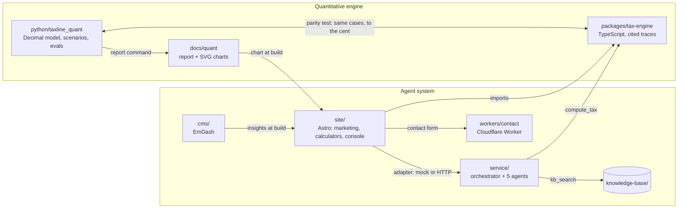
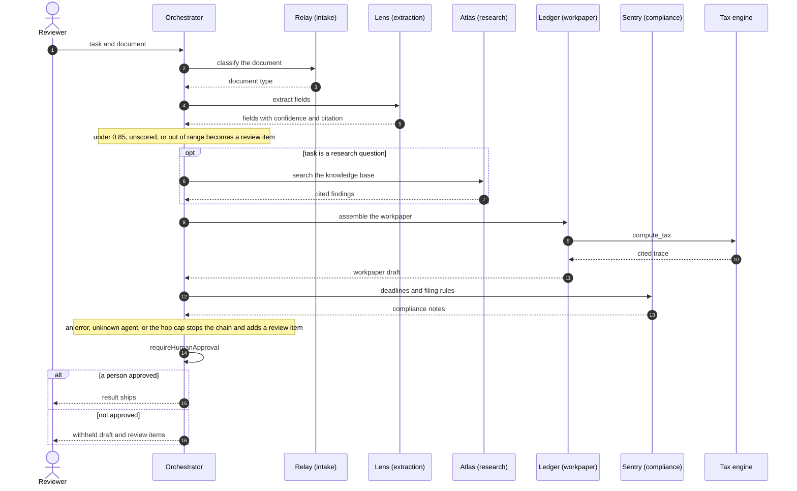
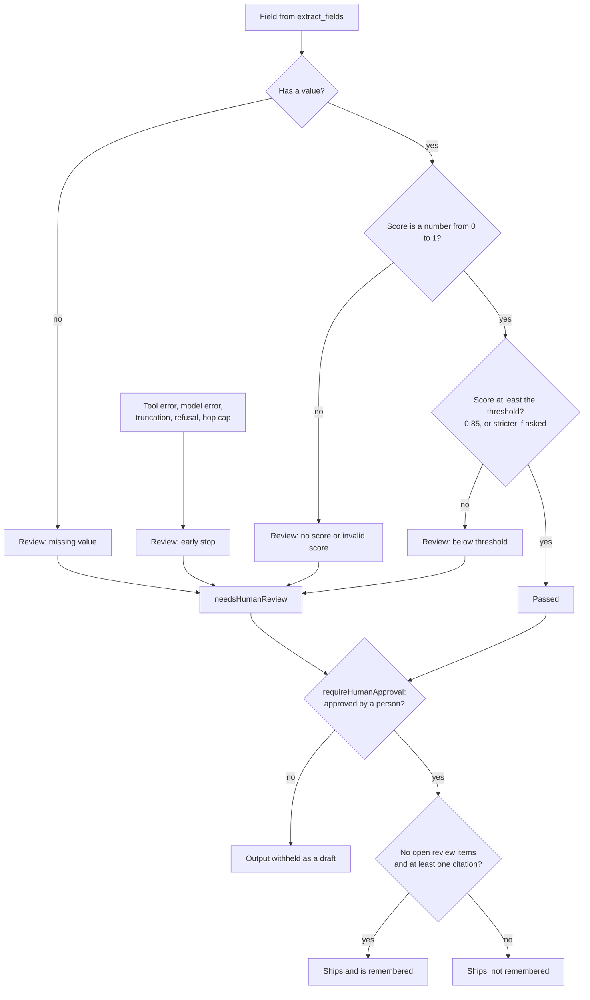
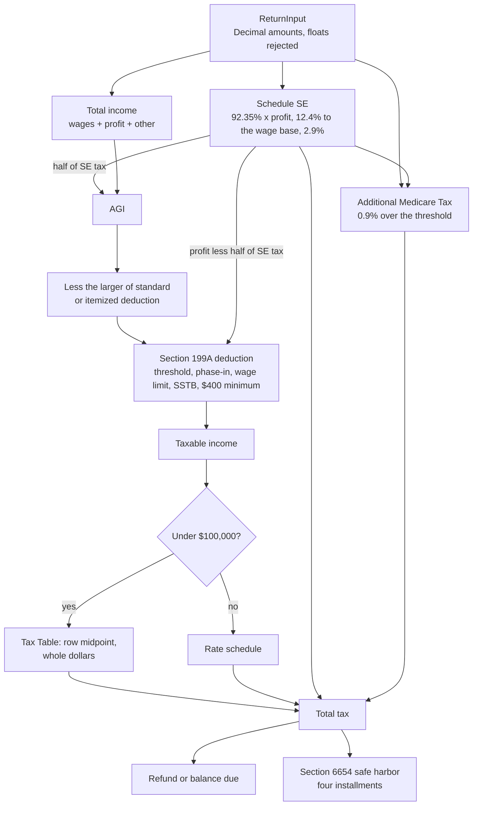
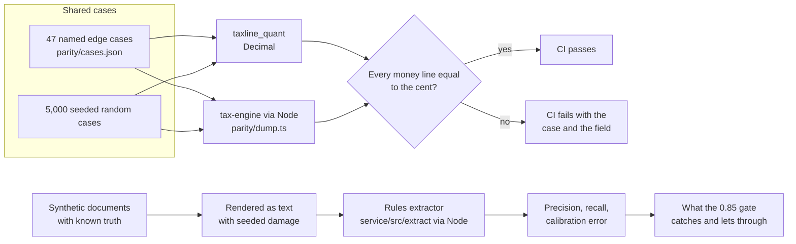

# Architecture

Taxline has two halves. The **agent system** takes tax documents from intake to a
reviewer-ready workpaper and stops at a human approval gate. The **quantitative
engine** is the deterministic math underneath it, written twice (TypeScript and
Python) so each implementation checks the other.

Not tax advice. All data is synthetic; the project is educational.

Deploy topology, trust boundaries, and failure modes are in
[system-design.md](system-design.md).

## 1. Components

What to notice: the site and the service both call the same TypeScript engine, so a
calculator and an agent cannot disagree about a number. The Python package never sits
in the request path. It reaches the product in two ways only: the parity test, and the
generated report whose chart the site inlines at build time.

## 2. The five-agent flow and the human gate

What to notice: agents never call each other. The orchestrator
([`service/src/orchestrator.ts`](../service/src/orchestrator.ts)) runs one agent,
follows that agent's static `handoff`, and aggregates. The entry agent is picked from
the task text or passed explicitly, so a run may start at Lens or Atlas; the chain
always ends at Sentry. The client's `maxHops` is clamped to 1 through 5 by
`clampMaxHops`, and the approval gate runs last on every path.

## 3. Confidence and review routing

What to notice: every branch is code in
[`service/src/tools/confidence.ts`](../service/src/tools/confidence.ts) and the
orchestrator, covered by [`service/test/confidence.test.ts`](../service/test/confidence.test.ts)
and [`orchestrator.test.ts`](../service/test/orchestrator.test.ts). The model can ask
for a stricter threshold but never a looser one, and a score it restates only counts
if it matches a field `extract_fields` actually returned. A fixed threshold is only as
good as the scores fed to it, which is what the evaluation harness in section 5
measures.

## 4. The Python model's calculation flow

What to notice: this is [`python/taxline_quant/model.py`](../python/taxline_quant/model.py).
Every box rounds half up to the cent on `Decimal`, the same points where the
TypeScript engine rounds. Each constant the boxes read is listed with its source in
[quant/constants.md](quant/constants.md), generated from
[`constants.py`](../python/taxline_quant/constants.py). The scope is narrower than the
TypeScript engine on purpose: no capital gains, credits, or NIIT.

## 5. How the two engines and the evaluation harness check the system

What to notice: the parity test is not a snapshot. Both engines run on every CI job
and the comparison has no tolerance for money. Its first run found that the
TypeScript engine rounded some exact half-cent ties down, because a product such as
43,230.95 x 0.9 reaches a double as 38,907.85499999999; the fix and its regression
test are in [`money.ts`](../packages/tax-engine/src/money.ts) and
[`engine.test.ts`](../packages/tax-engine/test/engine.test.ts). The evaluation harness
renders synthetic documents as damaged text, runs the service's rules extractor over
them through Node, and scores the result. It never calls a model API. Its published
numbers describe that extractor on a synthetic noise model, not a model and not real
scans; the confidence weights were set on seeds other than the one reported.
