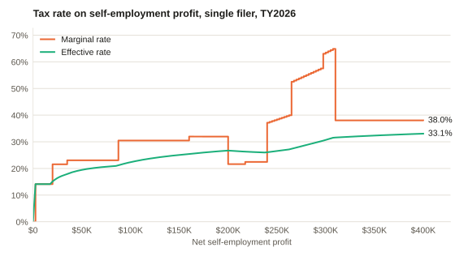
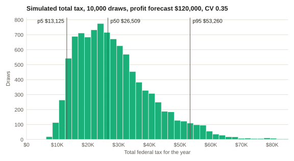
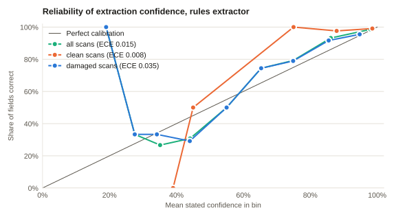
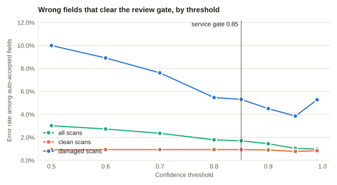

# Taxline quantitative report, tax year 2026

> Educational model on synthetic data for tax year 2026. Not tax, legal, or accounting advice. Do not file or pay based on this output.

Generated by `python -m taxline_quant report`. Every number below is recomputed
from the parameters in `python/taxline_quant/report.py`; a test fails if this file
drifts from what the code produces. Constants and their sources are in
[constants.md](constants.md).

## 1. Baseline

A single filer with $120,000 of net self-employment profit, no wages, and the standard deduction.

| Line | Form line | Amount |
| --- | --- | ---: |
| Total income | 1040 L9 | $120,000.00 |
| Adjustments to income | 1040 L10 | $8,477.73 |
| Adjusted gross income | 1040 L11 | $111,522.27 |
| Standard deduction | 1040 L12 | $16,100.00 |
| Qualified business income deduction | 1040 L13 | $19,084.45 |
| Taxable income | 1040 L15 | $76,337.82 |
| Income tax | 1040 L16 | $11,504.00 |
| Self-employment tax | Sch 2 L4 | $16,955.46 |
| Additional Medicare Tax | Sch 2 L11 | $0.00 |
| Total tax | 1040 L24 | $28,459.46 |
| Total payments | 1040 L33 | $0.00 |
| Amount owed | 1040 L37 | $28,459.46 |

Effective rate 23.72% of total income. Statutory bracket 22%.

## 2. Marginal and effective rates

<picture>
  <source media="(prefers-color-scheme: dark)" srcset="rates-dark.svg">
  
</picture>

The marginal rate is the change in total tax per extra dollar of profit, measured
over the next $100 on the exact rate schedule. It includes self-employment tax, its
deduction, and the QBI deduction, so it is not the bracket rate.

| Net profit | Total tax | Effective rate | Marginal rate | Bracket | QBI deduction |
| ---: | ---: | ---: | ---: | ---: | ---: |
| $50,000 | $9,729.78 | 19.46% | 23.04% | 12% | $6,073.52 |
| $100,000 | $22,366.55 | 22.37% | 30.49% | 22% | $15,367.04 |
| $150,000 | $37,604.33 | 25.07% | 30.48% | 22% | $24,660.57 |
| $200,000 | $53,430.61 | 26.72% | 21.62% | 24% | $33,956.57 |
| $250,000 | $66,360.03 | 26.54% | 38.40% | 24% | $36,151.78 |
| $300,000 | $92,124.55 | 30.71% | 63.49% | 35% | $6,302.63 |
| $350,000 | $113,210.79 | 32.35% | 38.04% | 35% | $400.00 |
| $400,000 | $132,231.10 | 33.06% | 38.04% | 35% | $400.00 |

Where the marginal rate moves by at least three points (profit in $100 steps):

| At profit | From | To |
| ---: | ---: | ---: |
| $400 | 0.00% | 70.65% |
| $500 | 70.65% | 14.13% |
| $17,700 | 14.13% | 18.38% |
| $17,800 | 18.38% | 23.42% |
| $85,100 | 23.06% | 29.50% |
| $199,800 | 30.25% | 21.62% |
| $237,900 | 24.92% | 36.91% |
| $262,600 | 39.96% | 45.46% |
| $262,700 | 45.46% | 52.15% |
| $296,500 | 57.74% | 61.38% |
| $307,900 | 64.61% | 38.04% |

The spike at $400 is the self-employment tax floor: no tax is due until net earnings
reach $400, then it is due on all of them. From about $238,000 to $308,000 the QBI
deduction phases out for a business with no W-2 wages (IRC sec. 199A(b)(3)(B)), which
lifts the marginal rate above 60% before it settles at the bracket rate plus Medicare.

## 3. What-if: profit by itemized deductions

Total tax. The standard deduction is $16,100, so the first two columns match until
itemized deductions exceed it.

| Net profit | Itemized $0 | Itemized $20,000 | Itemized $30,000 | Itemized $40,000 |
| ---: | ---: | ---: | ---: | ---: |
| $60,000 | $12,036.73 | $11,664.73 | $10,704.73 | $9,744.73 |
| $90,000 | $19,314.60 | $18,632.60 | $17,619.60 | $16,659.60 |
| $120,000 | $28,459.46 | $27,777.46 | $26,017.46 | $24,257.46 |
| $150,000 | $37,604.33 | $36,922.33 | $35,162.33 | $33,402.33 |
| $200,000 | $53,430.61 | $52,681.81 | $50,761.81 | $48,841.81 |
| $300,000 | $92,124.55 | $89,752.10 | $84,124.00 | $78,495.89 |

One-at-a-time sensitivity for a filer with $60,000 of wages, $120,000 of profit, and $22,000 of itemized deductions: change in total tax when each input moves 10%.

| Input | Base | -10% | +10% | Elasticity |
| --- | ---: | ---: | ---: | ---: |
| `self_employment_profit` | $120,000 | -$3,836.78 | $3,836.77 | 0.96 |
| `wages` | $60,000 | -$1,440.00 | $1,440.00 | 0.36 |
| `itemized` | $22,000 | $528.00 | -$528.00 | -0.13 |

## 4. Estimated payments under income uncertainty

<picture>
  <source media="(prefers-color-scheme: dark)" srcset="montecarlo-dark.svg">
  
</picture>

Assumptions:

- Tax year 2026 federal rules as modeled in taxline_quant; no state tax, credits, capital gains, or AMT.
- Annual net profit is lognormal with mean $120,000.00 and coefficient of variation 0.35. Real income is not lognormal; this is a stand-in for uncertainty.
- Only self-employment profit varies. Wages, deductions, and withholding are fixed.
- Installments are four equal payments under the regular method (IRC sec. 6654(d)(1)(A)); the annualized income method is not modeled.
- A shortfall means the plan paid less than the required annual payment. The underpayment penalty itself (IRC sec. 6654(a)) is not computed because it depends on quarterly interest rates and payment dates.
- 10,000 draws from numpy PCG64 with seed 20260415; percentiles are nearest-rank.

### Without a prior-year safe harbor

| Quantity | Mean | p5 | p25 | p50 | p75 | p95 |
| --- | ---: | ---: | ---: | ---: | ---: | ---: |
| Net profit | $120,298 | $64,730 | $90,251 | $113,595 | $142,358 | $199,397 |
| Total tax | $28,794 | $13,125 | $19,394 | $26,509 | $35,282 | $53,260 |
| Required annual payment | $25,915 | $11,813 | $17,455 | $23,859 | $31,753 | $47,934 |
| Required quarterly installment | $6,479 | $2,953 | $4,364 | $5,965 | $7,938 | $11,984 |

| Plan | Quarterly payment | Falls short of the requirement | Median shortfall | p95 shortfall | Balance at filing p5 | p50 | p95 |
| --- | ---: | ---: | ---: | ---: | ---: | ---: | ---: |
| `forecast-90` | $6,403.38 | 43.7% (SE 0.50%) | $7,509 | $27,785 | -$12,488 | $896 | $27,647 |

- `forecast-90`: Pay 90% of the tax on the forecast profit, less withholding, in four installments.

### With prior-year tax of $24,000 (prior-year AGI $110,000)

| Quantity | Mean | p5 | p25 | p50 | p75 | p95 |
| --- | ---: | ---: | ---: | ---: | ---: | ---: |
| Net profit | $120,298 | $64,730 | $90,251 | $113,595 | $142,358 | $199,397 |
| Total tax | $28,794 | $13,125 | $19,394 | $26,509 | $35,282 | $53,260 |
| Required annual payment | $20,635 | $11,813 | $17,455 | $23,859 | $24,000 | $24,000 |
| Required quarterly installment | $5,159 | $2,953 | $4,364 | $5,965 | $6,000 | $6,000 |

| Plan | Quarterly payment | Falls short of the requirement | Median shortfall | p95 shortfall | Balance at filing p5 | p50 | p95 |
| --- | ---: | ---: | ---: | ---: | ---: | ---: | ---: |
| `forecast-90` | $6,403.38 | 0.0% (SE 0.00%) | n/a | n/a | -$12,488 | $896 | $27,647 |
| `prior-year` | $6,000.00 | 0.0% (SE 0.00%) | n/a | n/a | -$10,875 | $2,509 | $29,260 |

- `forecast-90`: Pay 90% of the tax on the forecast profit, less withholding, in four installments.
- `prior-year`: Pay the prior-year safe harbor (100% or 110% of last year's tax), less withholding, in four installments.

Reading it: a plan built on the forecast falls short whenever profit beats the
forecast. The prior-year safe harbor removes that exposure by definition, but the
balance due at filing is as uncertain as before.

## 5. Extraction evaluation

600 synthetic documents (seed 7) with 2,800 known fields, rendered as the text a scan would yield and read by the rules extractor in `service/src/extract`, the code behind the service's `extract_fields` tool. The extractor is deterministic and offline, and it is not told which form it is reading. Its confidence comes from what it observes: how well the caption matches, whether the value fits its pattern, how damaged the rest of the document is, and whether the boxes agree with each other.

The damage is a seeded noise model (`python/taxline_quant/evals/render.py`): 70% clean scans (0.2% of characters misread, 0% of lines missing), 22% smudged scans (2.5% of characters misread, 1% of lines missing), 8% poor scans (8% of characters misread, 5% of lines missing). The confidence weights were set on seeds 11 and 23; seed 7 was held out. These numbers measure a rules extractor on synthetic text. They are not a measurement of a model, of OCR, or of real scans.

| Scans | Precision | Recall | F1 | ECE | Brier | Mean confidence | Accuracy | Sent to review at 0.85 | Errors past the gate | Errors caught |
| --- | ---: | ---: | ---: | ---: | ---: | ---: | ---: | ---: | ---: | ---: |
| all 600 | 95.8% | 92.7% | 0.942 | 0.015 | 0.030 | 94.7% | 95.8% | 11.4% | 42 (1.7%) | 63.5% |
| 440 clean scans | 98.9% | 98.6% | 0.987 | 0.008 | 0.010 | 98.2% | 98.9% | 0.6% | 19 (0.9%) | 17.4% |
| 121 smudged scans | 90.6% | 83.7% | 0.870 | 0.025 | 0.076 | 88.8% | 90.6% | 27.1% | 22 (5.4%) | 55.1% |
| 39 poor scans | 68.4% | 52.8% | 0.596 | 0.096 | 0.163 | 65.1% | 68.4% | 86.9% | 1 (4.3%) | 97.7% |

| Group | Correct | Wrong or invented | Missed | Precision | Recall |
| --- | ---: | ---: | ---: | ---: | ---: |
| 1099-INT | 749 | 34 | 51 | 95.7% | 93.6% |
| 1099-NEC | 740 | 39 | 60 | 95.0% | 92.5% |
| W-2 | 1,107 | 42 | 93 | 96.3% | 92.2% |
| id fields | 555 | 23 | 45 | 96.0% | 92.5% |
| money fields | 1,323 | 25 | 77 | 98.1% | 94.5% |
| text fields | 718 | 67 | 82 | 91.5% | 89.8% |

Names are the weakest group: a name has no pattern to check and no other box to agree with, so a misread letter can only be suspected from the damage around it.

<picture>
  <source media="(prefers-color-scheme: dark)" srcset="reliability-dark.svg">
  
</picture>

Reliability table, rules extractor, all scans:

| Confidence bin | Fields | Mean confidence | Accuracy | Gap |
| --- | ---: | ---: | ---: | ---: |
| 0.1 to 0.2 | 1 | 19.0% | 100.0% | 81.0% |
| 0.2 to 0.3 | 9 | 27.6% | 33.3% | 5.8% |
| 0.3 to 0.4 | 15 | 35.1% | 26.7% | 8.5% |
| 0.4 to 0.5 | 26 | 44.1% | 30.8% | 13.3% |
| 0.5 to 0.6 | 16 | 55.0% | 50.0% | 5.0% |
| 0.6 to 0.7 | 43 | 65.3% | 74.4% | 9.1% |
| 0.7 to 0.8 | 77 | 74.9% | 79.2% | 4.3% |
| 0.8 to 0.9 | 162 | 86.1% | 93.2% | 7.1% |
| 0.9 to 1.0 | 2362 | 98.0% | 98.6% | 0.6% |

<picture>
  <source media="(prefers-color-scheme: dark)" srcset="gate-dark.svg">
  
</picture>

| Threshold | all scans: review / error rate | clean scans: review / error rate | damaged scans: review / error rate |
| ---: | ---: | ---: | ---: |
| 0.5 | 5.0% / 3.01% | 0.5% / 0.93% | 17.4% / 9.98% |
| 0.6 | 5.6% / 2.72% | 0.5% / 0.93% | 19.6% / 8.91% |
| 0.7 | 7.1% / 2.35% | 0.5% / 0.93% | 25.4% / 7.61% |
| 0.8 | 9.9% / 1.78% | 0.6% / 0.93% | 35.7% / 5.46% |
| 0.85 | 11.4% / 1.69% | 0.6% / 0.93% | 41.4% / 5.30% |
| 0.9 | 15.6% / 1.44% | 2.6% / 0.90% | 51.9% / 4.49% |
| 0.95 | 24.0% / 1.03% | 5.5% / 0.77% | 75.4% / 3.85% |
| 0.99 | 38.0% / 0.98% | 18.5% / 0.83% | 92.3% / 5.26% |

Reading it: the gate does most of its work on damaged scans. What gets past it is mostly one digit or letter read as another on a field nothing else confirms. Those errors are why a person approves every result.

### What miscalibration would cost (simulated)

The rules extractor has one confidence model, so it cannot show what a badly calibrated one does. This comparison uses a simulator instead: two profiles that make the same mistakes on the same documents and differ only in the confidence they state. It is an illustration, not a measurement of any extractor.

| Profile | Precision | Recall | F1 | ECE | Brier | Mean confidence | Accuracy | Sent to review at 0.85 | Errors past the gate | Errors caught |
| --- | ---: | ---: | ---: | ---: | ---: | ---: | ---: | ---: | ---: | ---: |
| calibrated | 93.4% | 91.3% | 0.923 | 0.008 | 0.050 | 93.2% | 93.4% | 15.7% | 75 (3.2%) | 58.3% |
| overconfident | 93.4% | 91.3% | 0.923 | 0.035 | 0.057 | 96.9% | 93.4% | 4.6% | 151 (5.6%) | 16.1% |

A fixed threshold only protects the reviewer if the confidence is honest. With
inflated scores the same 0.85 gate sends fewer fields to a person and lets more
wrong values through, which is why calibration is measured and not assumed.
