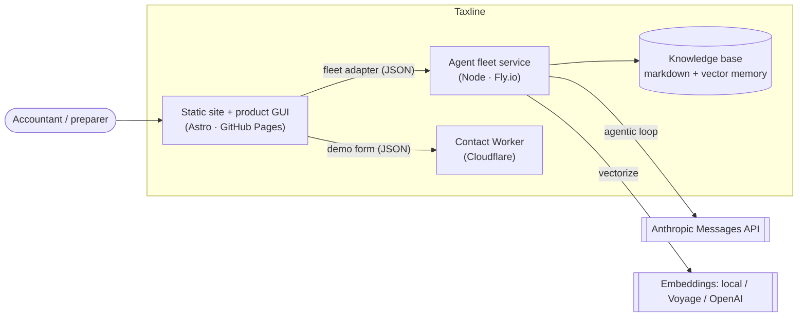
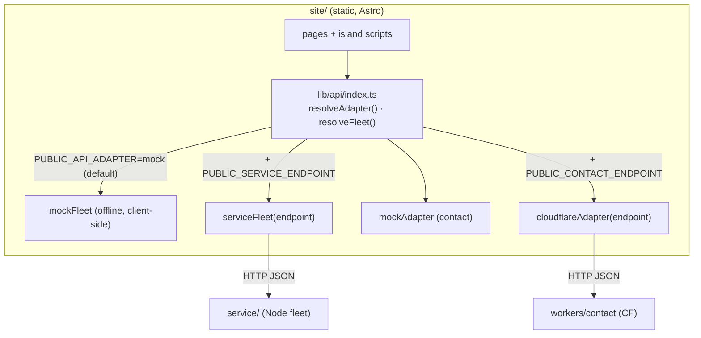
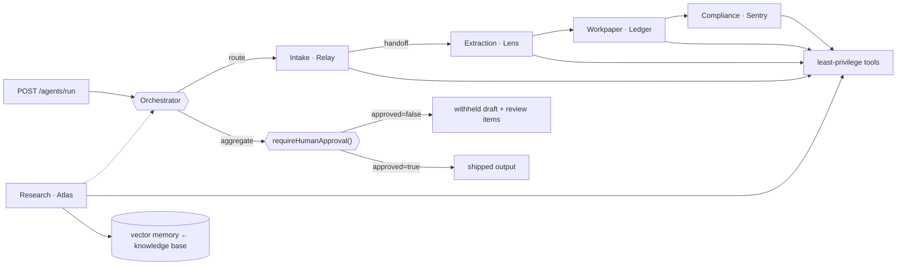
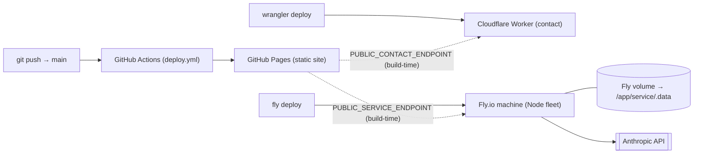

# Taxline — system design

_How the pieces fit, how data flows, where the trust boundaries are, and how to deploy._
_Companion to `design.md` (product spec) and `design-contract.md` (page-build rules)._

## 1 — Principles

- **GUI-first, human-approved.** End users are accountants. Nothing ships from the fleet
  until a person approves — enforced in code (`requireHumanApproval`), not by a prompt.
- **Static-first, honest about it.** The site is static (GitHub Pages serves files, no
  server). Anything dynamic goes through an **adapter** that defaults to a fully offline
  mock, so the product works with zero backend and upgrades to live when configured.
- **Agentic, never autonomous.** Hub-and-spoke fleet; the loop is driven by `stop_reason`;
  every field carries a confidence score and a citation; `<0.85` routes to human review.

## 2 — Context



The site never assumes a server exists. Two independent seams cross the boundary: the
**fleet adapter** (queue/doc/run/memory) and the **contact form** (demo requests).

## 3 — Containers & the adapter boundary

`site/src/lib/api/` is the seam. Each seam resolves at build time from
`PUBLIC_API_ADAPTER`; both default to an offline mock.



| Seam | Mock (default) | Live | Env to go live |
| --- | --- | --- | --- |
| `fleet` | `mockFleet` — simulates the orchestrator + gate in the browser | `serviceFleet` → Node service | `PUBLIC_API_ADAPTER` ≠ `mock` + `PUBLIC_SERVICE_ENDPOINT` |
| `api` (contact) | `mockAdapter` — validates + resolves | `cloudflareAdapter` → Worker | `PUBLIC_API_ADAPTER=cloudflare` + `PUBLIC_CONTACT_ENDPOINT` |

Both adapters honor the same contracts (`FleetService`, `ApiAdapter`), so any backend that
implements them (Azure Functions, Supabase, …) drops in without touching components.

## 4 — The fleet (service/)



- **Agentic loop** (`agent.ts`): `tool_use` → run tool, append `tool_result`, loop;
  `end_turn` → done. Iteration cap is a backstop only.
- **Orchestrator** (`orchestrator.ts`): decomposition, routing, error handling,
  aggregation, then the **gate as the last step**. Continuous learning calls
  `memory.remember()` **only after** the gate passes and only for cited, review-clean
  findings.
- **Memory** (`memory/`): heading-chunked KB embedded into a persistent flat-file vector
  store (`service/.data/memory.json`); retrieval is cosine top-k with a keyword fallback
  when the store is empty. Provider is `local` (offline) / `voyage` / `openai`.
- **Offline mode**: with no `ANTHROPIC_API_KEY`, each agent does a deterministic, clearly
  labeled tool run — degraded, never a silent fabrication.

## 5 — Deployment topology



| Component | Host | Trigger | State |
| --- | --- | --- | --- |
| Site | GitHub Pages | push to `main` (Actions) | none (static) |
| Contact Worker | Cloudflare | `wrangler deploy` | optional KV (leads) |
| Fleet service | Fly.io (Docker) | `fly deploy` | volume at `/app/service/.data` |

The site reads the live endpoints at **build time** (`PUBLIC_*`), so pointing it at the
fleet/Worker is a rebuild, not a code change.

## 6 — Trust & security boundaries

- **Human-approval gate** is programmatic and last; no path ships output without it.
- **Secrets** live only in `.env` / Wrangler secrets / Fly secrets / Actions secrets —
  never committed. `ANTHROPIC_API_KEY`, `VOYAGE/OPENAI_API_KEY`, `SLACK_WEBHOOK`.
- **CORS** on both backends is restricted to the site origin (`SITE_ORIGIN` /
  `ALLOWED_ORIGIN`).
- **Least privilege**: each agent gets only the tools its role needs; tool descriptions are
  the selection mechanism.
- **No training on client data**; documents stay in the workspace; no autonomous filing.
- **Contact form**: honeypot + email validation on both the mock and the Worker.

## 7 — Failure modes & degradation

| Failure | Behavior |
| --- | --- |
| No `ANTHROPIC_API_KEY` | Service boots in deterministic offline mode (labeled). |
| Fleet service unreachable | `serviceFleet` reads return empty/offline; the UI shows "service unreachable". |
| Memory store empty/corrupt | Retrieval falls back to keyword scoring; a corrupt file starts empty (logged), next write rewrites it. |
| Embeddings provider error | Structured `transient` error surfaced, not a silently-wrong vector. |
| Tool throw | Caught as a structured `transient` error; the run continues or surfaces for a human. |

## 8 — Deploy runbook

**Site → GitHub Pages** (automatic): push to `main`; `deploy.yml` builds with
`SITE_URL`/`BASE_PATH` and publishes `site/dist`. To wire the live backends, set repo/Actions
build env `PUBLIC_API_ADAPTER`, `PUBLIC_SERVICE_ENDPOINT`, `PUBLIC_CONTACT_ENDPOINT` and
rebuild.

**Contact Worker → Cloudflare**:
```bash
cd workers/contact
wrangler kv namespace create LEADS     # optional; paste id into wrangler.toml
wrangler secret put SLACK_WEBHOOK       # optional
wrangler deploy                         # prints the Worker URL
```

**Fleet service → Fly.io** (from repo root; uses `Dockerfile` + `fly.toml`):
```bash
fly launch --no-deploy
fly volumes create taxline_data --size 1 --region iad
fly secrets set ANTHROPIC_API_KEY=sk-ant-... SITE_ORIGIN=https://patrickking67.github.io
fly deploy
```
Then rebuild the site with `PUBLIC_API_ADAPTER=service` and
`PUBLIC_SERVICE_ENDPOINT=https://taxline-service.fly.dev`.

## 9 — Scaling & cost notes

- **Model tiers**: `claude-haiku-4-5` for classify/intake; `claude-opus-4-8` for
  research/workpaper/extraction. Pick the smallest model that meets the accuracy bar.
- **Batches API** (≈50% cheaper, ≤24h, no multi-turn tools) is for overnight bulk only —
  never the interactive path.
- **Memory** is a brute-force flat-file store: fine for this KB size; swap `VectorStore`
  for a real vector DB behind the same methods when the corpus grows. Keep ≥1 Fly machine
  warm so the index stays in process.
- **Embeddings**: `local` is free/offline but lexical-only; move to `voyage`/`openai` for
  real semantics, then `POST /memory/index` once to re-embed.
